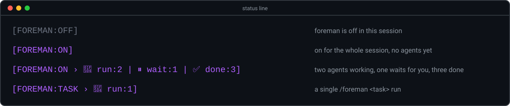

<h1 align="center">foreman</h1>
<p align="center">
  
  
</p>

<h3 align="center">The foreman plans. The crew builds.</h3>

<p align="center">
  
</p>

## What it is

One Claude Code session can do a lot on its own. But when a task has several independent pieces, doing them inline fills the main context with file dumps and test output, runs the pieces one after another, and leaves you trusting the session's own word that each one worked.

foreman is a Claude Code plugin that turns the main session into an orchestrator. Like a foreman on a building site, it reads the plan, splits the work, hands each piece to a crew member and checks the result - but it does not lay bricks itself. The main session plans, spawns subagents, relays between them and verifies what they return; the subagents do the work.

You turn it on with `/foreman on` for the whole session, or run a single task or skill through it with `/foreman <task>`.

## Features

- **The main context stays clean** - every change, even a one-liner, goes to a subagent; the main session keeps only the conclusions.
- **Parallel pieces** - pieces that do not depend on each other are spawned in one message, so they run at the same time; only a real dependency is serialized.
- **Verified results** - an agent's `done` is a claim, not proof. The foreman reads the diff or runs the check before accepting it, and reports what stays not verified.
- **One level deep** - only the main session spawns agents. Agents never spawn agents, never message each other, and report only to the foreman. A hook enforces it.
- **A fitting agent per piece** - locating, small edits, reviews, plans and multi-step work each go to a matching agent type, with a cheaper model and lower effort for mechanical pieces.
- **Agent board** - one table of every agent, its job and its stage (`queued`, `running`, `waiting`, `verifying`, `done`, `failed`), kept in step by hooks.
- **Status line badge** - `[FOREMAN:ON]`, `[FOREMAN:TASK]` or `[FOREMAN:OFF]` with the board's counts.
- **Runs other skills** - `/foreman <skill> <args>` runs a skill with its work going to agents while its user gates and git steps stay with the main session.
- **Survives compaction** - the mode lives in a per-session flag; after a compaction or resume a hook tells the session to re-read the skill and reconcile the board.
- **Live view** - optional [foreman-vision](https://github.com/ilkemerol/foreman-vision-pub) shows each foreman session as a floor of a pixel-art office.
- **Optional tracking** - work that spans sessions can be tracked with [beads](https://github.com/gastownhall/beads) (`bd`).

## Quick Start

### Requirements

- [Claude Code](https://docs.anthropic.com/en/docs/claude-code). foreman is a Claude Code plugin and relies on its hooks and subagents.
- `git`, only to install from the repo instead of as a plugin.
- `bash` 3.2 or newer and [`jq`](https://jqlang.github.io/jq/) 1.6 or newer in the shell Claude Code runs hooks in. On Windows that is Git Bash; install `jq` there too.
- Recommended: the [superpowers](https://github.com/obra/superpowers) plugin, for planning, debugging and review skills foreman can run.
- Optional: the [caveman](https://github.com/JuliusBrussee/caveman) plugin (needs Node.js). foreman prefers its `caveman:cavecrew-*` agent types for small pieces and falls back to `Explore` and `general-purpose` without it.
- For the optional live view: Node.js and `curl`, plus foreman-vision itself (see its README).
- For the optional tracking: `bd`. foreman offers to install it when it is needed and you say yes.

### Install

Ask your agent:

```text
Install foreman by following https://raw.githubusercontent.com/ilkemerol/foreman/main/INSTALL.md
```

[INSTALL.md](INSTALL.md) checks the tools, installs foreman the way you choose, sets up the status line, offers the optional plugins and runs the checks.

There are two ways to install foreman. Pick one: with both on one machine, both load as plugins and every hook runs twice. Paths here say `~/.claude`; foreman honors `CLAUDE_CONFIG_DIR` when it is set.

**As a plugin (recommended).** This repo is its own plugin marketplace:

```sh
claude plugin marketplace add ilkemerol/foreman
claude plugin install foreman@foreman
```

Inside a session the same is `/plugin marketplace add ilkemerol/foreman` and `/plugin install foreman@foreman`. Then restart Claude Code, or run `/reload-plugins`. The hooks come with the plugin and load with it; there is nothing to merge into `settings.json`.

Update with `claude plugin update foreman@foreman`, then `/reload-plugins` or a restart. Third-party marketplaces do not update on their own by default; turn that on under `/plugin` > Marketplaces. Remove with `claude plugin uninstall foreman@foreman`.

**From the repo.** Clone it into your skills folder and keep it at this path:

```sh
git clone https://github.com/ilkemerol/foreman.git ~/.claude/skills/foreman
```

The clone carries the plugin manifest, so Claude Code loads it as the plugin `foreman@skills-dir`, hooks included; there is nothing to merge into `settings.json`. An older foreman clone merged its hooks into `settings.json`: remove those entries, or every hook runs twice. [INSTALL.md](INSTALL.md) step 4 has a `jq` command that does it. `claude plugin list` should show `foreman@skills-dir` enabled. Update with `git -C ~/.claude/skills/foreman pull --ff-only`, then restart.

[references/wiring.md](references/wiring.md) lists every piece of wiring.

### Add the status line badge

<p align="center">
  
</p>

[bin/foreman-statusline.sh](bin/foreman-statusline.sh) prints the badge, `[FOREMAN:ON]`, `[FOREMAN:TASK]` or `[FOREMAN:OFF]`, with the board's stage counts, for example `[FOREMAN:ON › 🔄 run:1 | ⏸️ wait:1]`. It is pure bash and reads foreman's per-session files:

- `~/.claude/foreman/state/active-<session id>` - the mode flag, one line: `on` or `task`.
- `~/.claude/foreman/state/board-<session id>` - the agent board, tab-separated: row number, agent id, type, job, stage, note.

foreman does not set the status line for you; a plugin cannot. The plugin's folder changes with every update, so at each session start foreman's hook copies the script to a path that stays put, `~/.claude/foreman/foreman-statusline.sh`. The copy appears after the first session start with foreman installed. This works the same for both install methods.

No status line yet? Set it in `~/.claude/settings.json`:

```json
"statusLine": { "type": "command", "command": "bash ~/.claude/foreman/foreman-statusline.sh", "refreshInterval": 15 }
```

Already have one? Pass it the same JSON input:

```bash
# inside your status line script, after reading Claude Code's JSON input into $input
printf '%s ' "$(printf '%s' "$input" | bash ~/.claude/foreman/foreman-statusline.sh)"
```

### Talk to it

```text
> /foreman on
  Foreman mode is on for this session.

> fix the flaky login test, add dark mode to the settings page, and review the auth module

  # foreman splits this into three independent pieces, spawns three agents in one
  # message, keeps the board up to date, verifies each result, then reports the
  # outcome, what it verified, and any decision that is still yours.

> /foreman off
```

## Commands

```
/foreman on               orchestrator mode on for this session
/foreman off              mode off
/foreman status           show the mode and the agent board
/foreman <task>           run one task in orchestrator mode
/foreman <skill> <args>   run a skill in orchestrator mode (e.g. my-skill 123)
```

- `/foreman` with no arguments prints the usage and does nothing else.
- `on` lasts until `off`. `/clear` starts a new session id, so the mode ends there.
- A one-shot (`<task>` or `<skill> <args>`) shows `[FOREMAN:TASK]` and stays open across the called skill's gates and your answers. It ends when the skill has no step left, the task is done, or you drop it.
- As a plugin its full name is `/foreman:foreman`; use that when another skill named `foreman` takes `/foreman`.
- The first word is treated as a skill only when it exactly matches one of your installed skills; an ordinary verb such as `run` or `loop` followed by a sentence is a task.

## How It Works

```
                    you
                     │  the ask, answers, decisions
                     ▼
 ┌────────────────────────────────────────────┐
 │ foreman (the main session)                 │
 │ splits the task · spawns · relays · checks │
 │ keeps the agent board                      │
 └──┬───────────────────┬─────────────────┬───┘
    │ one Agent call per piece, independent pieces in one message
    ▼                   ▼                 ▼
 ┌─────────┐       ┌─────────┐       ┌─────────┐
 │ agent 1 │       │ agent 2 │  ...  │ agent N │   one piece each
 └────┬────┘       └────┬────┘       └────┬────┘
      └─ done | blocked | needs-decision | needs-agent | needs-info ─► foreman
```

### The rules

- **The foreman does not do the work.** It talks with you, reads what it needs to split, route and verify, runs tests, lands worktree commits, and runs the git steps and user gates of a skill it orchestrates. Every edit of the work goes to an agent.
- **The crew reports only to the foreman.** When an agent needs another agent or information another piece owns, it returns `needs-agent` or `needs-info`. The foreman spawns that agent or gets the answer and sends it back with `SendMessage`, which resumes the agent with its context intact.
- **A status, not a story.** Every agent returns one status first: `done`, `blocked`, `needs-decision`, `needs-agent` or `needs-info`, then the details and any follow-ups it noticed outside its ask.
- **Each piece gets a fitting agent:**

  | Piece | Agent type |
  |-------|-----------|
  | Find where something is / map code | `caveman:cavecrew-investigator` or `Explore` |
  | Edit confined to 1-2 files, nothing to run | `caveman:cavecrew-builder` or `general-purpose` |
  | Review a diff or file | `caveman:cavecrew-reviewer` or `general-purpose` |
  | Design an implementation plan | `Plan` |
  | Multi-step work, 3+ files, shell, tests, commits, research | `general-purpose` |

- **Same file, two agents** - they run one after another, or each in its own git worktree, landed by fast-forward or cherry-pick.
- **Confirmations** - a push, a delete, an external send, or a commit no plan scheduled is confirmed with you first, one action at a time.

### Agent board

Every spawned agent gets a row; every status change moves it. Hooks add the row when an agent is spawned, set it `running` on start or resume and `verifying` when it stops; the foreman moves it to `waiting`, `done` or `failed`. `/foreman status` prints it:

```
| # | Agent | Type | Job | Stage | Note |
|---|-------|------|-----|-------|------|
| 1 | a1b2c3 | general-purpose | fix flaky login test | 🔍 verifying | |
| 2 | d4e5f6 | caveman:cavecrew-builder | dark mode toggle | ✅ done | tests pass |
| 3 | 0718aa | caveman:cavecrew-reviewer | review auth module | ⏸️ waiting | needs-decision: scope |
```

[bin/foreman-state.sh](bin/foreman-state.sh) is the only writer of the flag and the board.

### Hooks

| Hook | Event | What it does |
|------|-------|--------------|
| [nested-agent-guard.sh](hooks/nested-agent-guard.sh) | PreToolUse | While the mode is on, denies a subagent's `Agent`, `SendMessage`, `Workflow`, `CronCreate`, `RemoteTrigger`, `EnterWorktree` and `Monitor` calls and orchestration skills, and tells it which status to return instead. The main session is never blocked. |
| [master-edit-guard.sh](hooks/master-edit-guard.sh) | PreToolUse | While the mode is on, denies the main session's `Edit`, `Write` and `NotebookEdit` outside the Claude config folder and the session scratchpad. Subagents are never blocked. |
| [board-sync.sh](hooks/board-sync.sh) | PostToolUse, SubagentStart, SubagentStop | Keeps the board rows in step with the foreman's agents. |
| [subagent-contract.sh](hooks/subagent-contract.sh) | SubagentStart | Gives every agent the standing contract in [references/agent-contract.md](references/agent-contract.md): its boundaries and return statuses. |
| [session-start.sh](hooks/session-start.sh) | SessionStart | Removes flags and boards idle for 14 days; copies the status line script to `~/.claude/foreman/` when it is missing or changed; after a compaction or resume, re-injects the mode so the session re-reads the skill and reconciles the board. |

They are listed in [hooks/hooks.json](hooks/hooks.json), which Claude Code loads for both install methods. All hooks fail open: on unreadable input they do nothing.

## foreman-vision

[foreman-vision](https://github.com/ilkemerol/foreman-vision-pub) is a live view in the browser. Every Claude Code session becomes a floor of a small office building; each subagent walks to a desk, waits in the waiting room when it needs you, and heads to the Done lounge when it finishes. With foreman on, the floor also shows the board's jobs, notes and stages.

foreman starts and stops it for you at two moments, through [bin/foreman-vision.sh](bin/foreman-vision.sh):

- **Mode turns on** - if foreman-vision is installed but stopped, foreman asks whether to start it, then gives you the URL. If it is already running, you just get the URL.
- **Mode turns off** - if no other foreman session uses it, foreman asks whether to stop it; otherwise it only offers to hide this session's floor.

foreman finds foreman-vision either way it is installed: a clone wired through hooks in `~/.claude/settings.json`, or the foreman-vision plugin. If foreman-vision is not installed, foreman says nothing about it.

## Tracking with beads

For work that spans sessions, or when you ask for it, foreman can track the pieces with [beads](https://github.com/gastownhall/beads) (`bd`): an epic for the task, one issue per piece, dependencies, claims and closes. It needs a plan folder, never writes to a repo's own `.beads/`, and asks before installing `bd`. Details: [references/beads.md](references/beads.md).

## Tests

From the installed plugin's folder (`installPath` in `claude plugin list --json`), or from any clone of this repo:

```sh
bash eval/check.sh
```

[eval/check.sh](eval/check.sh) runs deterministic checks for the flag, the board, the status line badge and the hooks against a throwaway config folder; it touches nothing real. The routing checks read the matchers in the shipped [hooks/hooks.json](hooks/hooks.json). The badge checks run [bin/foreman-statusline.sh](bin/foreman-statusline.sh), or the script in `STATUSLINE`.

[eval/SCENARIOS.md](eval/SCENARIOS.md) lists the behavior scenarios a script cannot test - how the model acts under the skill - to run by hand in a fresh session.

## Repository layout

- [.claude-plugin/](.claude-plugin/) - `plugin.json` (the plugin) and `marketplace.json` (this repo as its own marketplace).
- [SKILL.md](SKILL.md) - the skill itself: modes, rules, the master's job, the board.
- [references/one-shot.md](references/one-shot.md) - `/foreman <task>` and `/foreman <skill> <args>` runs.
- [references/called-skills.md](references/called-skills.md) - orchestrating another skill: whose work, whose gates.
- [references/agent-contract.md](references/agent-contract.md) - the standing contract every agent gets.
- [references/beads.md](references/beads.md) - optional beads tracking.
- [references/wiring.md](references/wiring.md) - hooks, status line and state files.
- [bin/](bin/) - `foreman-state.sh` (flag and board), `foreman-statusline.sh` (badge) and `foreman-vision.sh` (live view).
- [hooks/](hooks/) - `hooks.json` (Claude Code loads it for both install methods) and the five hooks above.
- [eval/](eval/) - `check.sh` and `SCENARIOS.md`.
- [assets/](assets/) - the README pictures, `foreman.svg` and `badges.svg`, and the stdlib Python scripts that draw them (`banner.py`, `badges.py`).

## License

[MIT](LICENSE)
